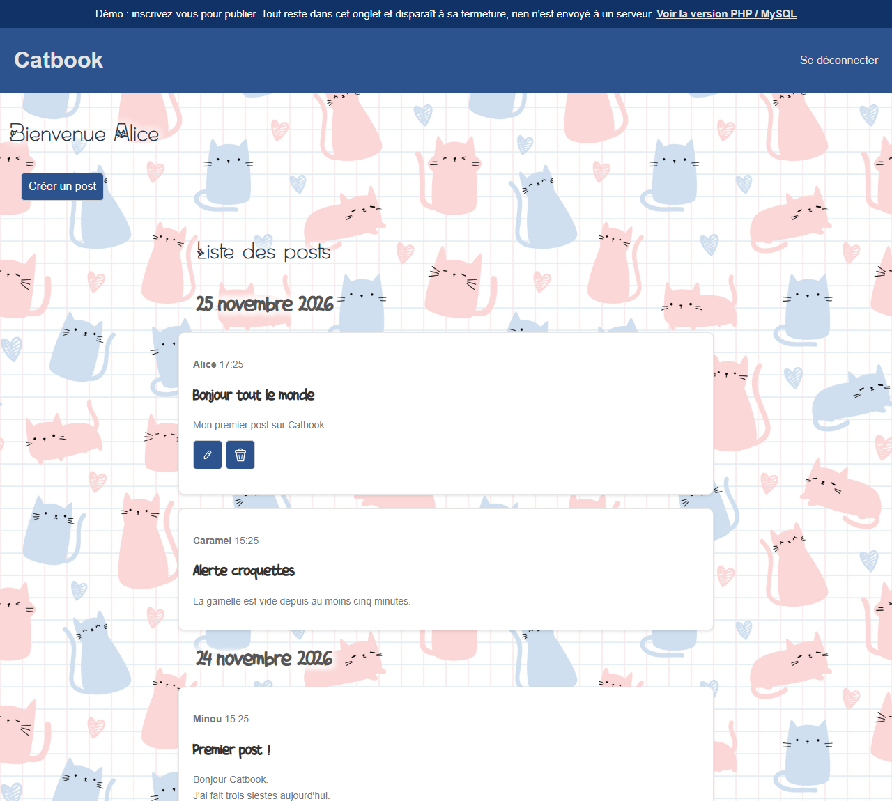

# Catbook

A small social network in PHP and MySQL, with a hand-written MVC architecture.
Create an account, log in, and post messages that you can edit or delete. Made during my web developer training.

**[▶ Try the online demo](https://suzonz.github.io/socialNetwork/)**

> The online demo is a browser-only copy of the pages (same HTML and CSS, in `docs/`):
> accounts and posts stay in your browser tab and disappear when you close it. Nothing is sent to a server.
> The real app, in PHP with MySQL, is at the root of this repository.



The app is in French.

## What it shows

- **MVC written by hand**: a router (`core/Router.php`), controllers, models with repositories, and views
- **Accounts**: sign up with checks (pseudo format, strong password, valid email, unique pseudo),
  passwords hashed with `password_hash`, log in and out with PHP sessions
- **Posts**: create, edit, delete; only the author can edit or delete their own posts
- **Security**: prepared statements everywhere (no SQL injection), output escaped with `htmlspecialchars`,
  session cookie `HttpOnly` and `SameSite=Lax`, technical errors hidden online

## Run it locally

1. Create a MySQL database named `yolo` (or another name, see below) and import `database.sql`.
2. Serve the `public/` folder with PHP, for example: `php -S localhost:8000 -t public`.
3. Open <http://localhost:8000>.

The database settings come from environment variables, with local defaults:

| Variable | Default |
|---|---|
| `DB_HOST` | `localhost` |
| `DB_NAME` | `yolo` |
| `DB_USER` | `root` |
| `DB_PASSWORD` | *(empty)* |
| `APP_DEBUG` | errors shown; set `0` online to hide them |

## Project structure

```
public/index.php      entry point: session, includes, router
core/Router.php       /login → LoginController, /post → PostController…
src/controllers/      one controller per page (Main, Login, Register, Logout, Post, Edit, Delete)
src/models/           User, Post, database connection, repositories (SQL queries)
views/                the HTML pages
database.sql          the user and post tables
docs/                 online demo for GitHub Pages (browser only, no server)
screenshots/          images used in this README
```

## Credits

- App and code: **Suzonz**
